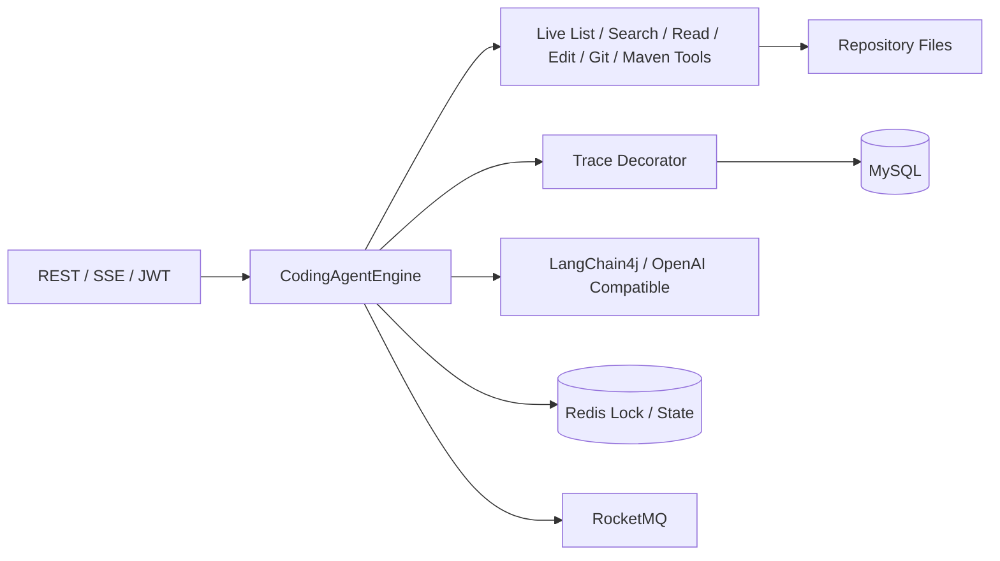
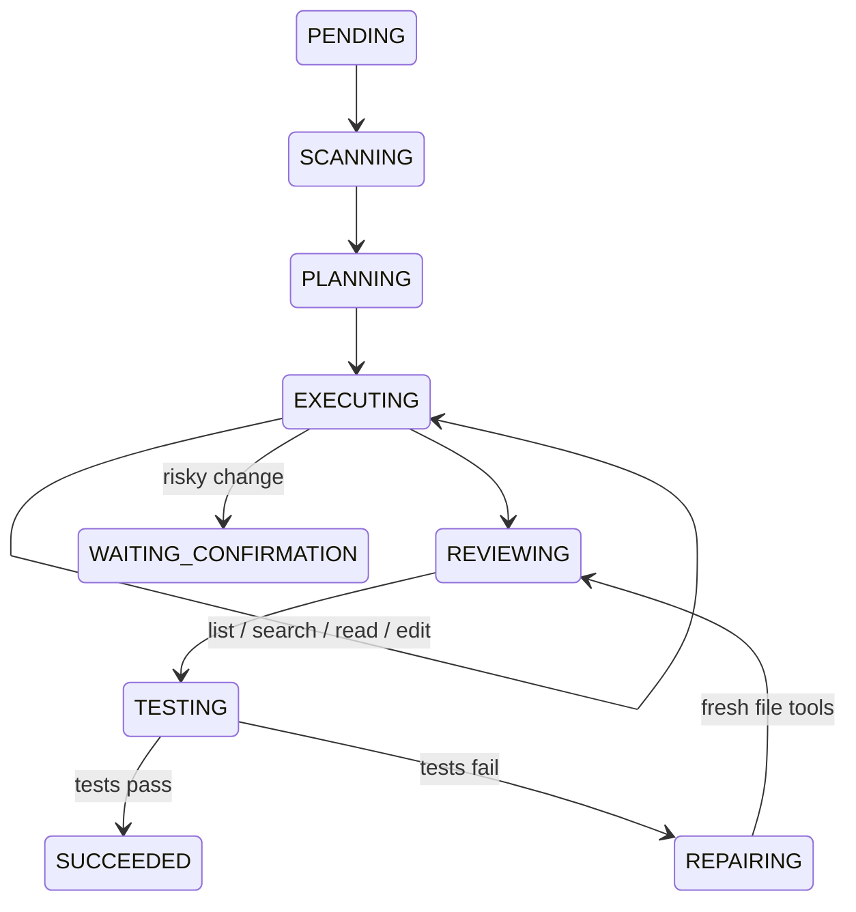

# Java Coding Agents

基于 Java 17、Spring Boot 3 与 LangChain4j 构建的 Java 编程智能体。它面向真实 Maven 仓库，直接列出、搜索、读取和修改工作区文件，提供结构化规划、Git Diff、测试、自修复和执行轨迹查询等能力，任务执行不再建立或保存代码 RAG 索引。

## 核心能力

- **直接操作代码**：模型根据工具反馈循环选择列文件、文本搜索、按行读取、创建文件或精确替换，无需预先切片和入库，支持 Java 及其他 UTF-8 文本文件。
- **实时上下文**：每次工具调用都读取当前工作区，修复轮次重新获取文件内容；JavaParser 和旧 RAG 模块作为独立库保留，主执行链路不再依赖它们。
- **工具调用**：统一使用结构化 `ToolResult`，提供受控文件读写、局部 Patch、只读 Git/Maven 命令和任务快照。
- **自动修复**：测试失败后解析结构化错误，重新搜索、读取、修改并测试；支持最大轮次、重复错误、无效变更和工具步数等停止条件。
- **执行追踪**：以 `traceId`、`taskId` 和 `sessionId` 关联计划、工具、文件、测试与修复事件，不保存模型隐藏推理。
- **安全控制**：限制工作区路径与可执行命令，敏感文件和高风险变更进入人工确认流程。

## 系统架构



## 执行流程



## 项目模块

| 模块 | 职责 |
| --- | --- |
| `coding-agent-bootstrap` | 应用启动、Bean 装配、JWT/Security、Metrics 和配置 |
| `coding-agent-api` | REST、SSE、DTO、参数校验与异常处理 |
| `coding-agent-core` | Supervisor、规划/编码模型、状态机和自动修复 |
| `coding-agent-analysis` | 独立的 Maven 扫描与 JavaParser 分析库，主流程不依赖 |
| `coding-agent-rag` | 保留的旧索引/检索库，主流程不依赖 |
| `coding-agent-tools` | 实时列文件、文本搜索、按行读取、安全修改、Git、Maven、快照和回滚工具 |
| `coding-agent-trace` | 结构化 Trace 与异步写入 |
| `coding-agent-infrastructure` | LangChain4j、MySQL、Redis、RocketMQ 和 JGit 适配 |
| `coding-agent-common` | 公共领域对象与 API 响应模型 |

## 技术栈

- Java 17
- Spring Boot 3.4
- Maven 多模块工程
- LangChain4j / OpenAI Compatible API
- JavaParser
- MySQL、Redis、Milvus、RocketMQ
- JWT、Spring Security、Springdoc OpenAPI
- JUnit 5、Testcontainers

## 快速开始

### 环境要求

- JDK 17+
- Maven 3.9+
- Docker 与 Docker Compose（运行外部服务时需要）

### 1. 运行测试

```bash
mvn -s .mvn/settings.xml test
```

### 2. 启动基础设施

```bash
docker compose -f deploy/docker-compose.yml up -d
```

### 3. 启动应用

```bash
mvn -s .mvn/settings.xml -pl coding-agent-bootstrap -am spring-boot:run
```

应用默认监听 `http://localhost:8080`，Swagger UI 位于：

```text
http://localhost:8080/swagger-ui.html
```

### Windows 离线兜底与前端

复制 `.env.example` 为根目录下的 `.env`，填写 `ADMIN_PASSWORD` 和至少 32 字节的 `JWT_SECRET`。如需保存模型密钥，可填写 `LLM_API_KEY`；`.env` 已被 Git 忽略。然后在 PowerShell 中运行：

```powershell
.\run-offline.ps1
```

Windows 下也可以双击根目录的 `start.cmd` 一键构建并启动；首次使用仍需先按上文配置 `.env`。脚本会打开独立命令窗口并保留启动日志；应用运行期间不要关闭该窗口。

若要从另一个窗口关闭已启动的应用，双击根目录的 `stop.cmd`。脚本只会停止监听配置端口且命令行匹配本项目 JAR 的 Java 进程；停止结果会保留在独立命令窗口中。

脚本会强制清空模型地址和模型名称，因此始终使用确定性离线模型，不向模型服务发送请求。启动后访问 `http://localhost:8080/`，使用 `.env` 中的管理员账号登录，添加本机已存在的仓库路径，再提交任务查看测试结果和轨迹。离线模型不会提出文件修改；任务会对所选仓库执行 `mvn test`。仓库与任务记录当前保存在内存中，重启后需要重新添加。

侧栏底部的“界面主题”支持浅色、深色和跟随系统，登录前后均可切换。主题选择保存在当前浏览器中，刷新后保留；跟随系统会响应系统外观变化。浏览器禁用本地存储时，仍可在当前页面切换主题。

页面运行模式读取自 `/api/health` 的 `mode` 字段（`OFFLINE` / `ONLINE`，不包含密钥）。任务查询返回实时 `status` 以及可选的 `stopReason`、`message`，供页面展示执行阶段和停止原因；异常内容不会直接暴露到接口。

## 配置项

| 环境变量 | 说明 |
| --- | --- |
| `LLM_BASE_URL` | OpenAI Compatible API 地址 |
| `LLM_MODEL_NAME` | 模型名称 |
| `LLM_API_KEY` | 模型 API Key；未配置时使用确定性离线模型 |
| `JWT_SECRET` | JWT 密钥，建议至少 32 字节 |
| `ADMIN_USERNAME` | 管理员用户名 |
| `ADMIN_PASSWORD` | 管理员密码 |
| `AGENT_WORKSPACE_ROOT` | 代码仓库工作区根目录，默认 `./workspaces` |
| `AGENT_MAX_REPAIR_ATTEMPTS` | 最大自动修复次数，默认 `3` |
| `SERVER_PORT` | HTTP 服务端口，默认 `8080` |

> 请通过环境变量注入密钥，不要把真实凭据提交到仓库。

## API 示例

获取访问令牌：

```bash
curl -X POST http://localhost:8080/api/auth/token \
  -H "Content-Type: application/json" \
  -d '{"username":"admin","password":"your-password"}'
```

创建代码仓库记录：

```bash
curl -X POST http://localhost:8080/api/repositories \
  -H "Authorization: Bearer TOKEN" \
  -H "Content-Type: application/json" \
  -d '{"name":"demo","workspacePath":"/workspace/demo","userId":1}'
```

创建编程任务：

```bash
curl -X POST http://localhost:8080/api/agent/tasks \
  -H "Authorization: Bearer TOKEN" \
  -H "Content-Type: application/json" \
  -d '{"repositoryId":1,"requirement":"增加手机号验证码登录并补充测试","maxRepairCount":3}'
```

任务相关接口包括：

- `GET /api/agent/tasks/{taskId}/trace`
- `GET /api/agent/tasks/{taskId}/tools`
- `GET /api/agent/tasks/{taskId}/changes`
- `GET /api/agent/tasks/{taskId}/tests`
- `GET /api/agent/tasks/{taskId}/metrics`
- `GET /api/agent/tasks/{taskId}/events`

## 自动修复示例

`examples/sample-user-service` 是一个可独立测试的示例服务。真实模型返回结构化 `WorkspaceAction`，按需调用 `LIST_FILES`、`SEARCH_FILES`、`READ_FILE`、`APPLY_CHANGES`，收到工具结果后继续下一步。`APPLY_CHANGES` 使用已有 `ChangeProposal`，支持创建文件和精确 Patch；已有文件必须先读取。模型返回 `FINISH` 后，引擎执行 `git diff` 和 `mvn test`。失败输出转换为 `StructuredError`，下一轮重新读取修改后的文件。

每轮最多 40 个工具步骤，达到上限会以 `CONTEXT_LIMIT_REACHED` 停止；单次列出/搜索最多 200 条结果，单次读取最多 400 行 / 24,000 字符，文本文件大小上限 1 MiB。截断结果会提示缩小搜索范围或继续读取后续行。默认跳过 `.git`、快照、构建产物和依赖目录；不将源码保存到索引库，修改前的原文件仍保留在 `.agent-snapshots` 用于回滚。

## 安全边界

- 所有文件路径必须位于仓库根目录内。
- 拒绝绝对路径、路径穿越、符号链接以及 `.env`、私钥、`.git` 和快照等敏感路径的模型访问。
- 命令执行采用白名单，只允许 Maven、Maven Wrapper、只读 Git 命令和 `java -version`。
- 构建文件、数据库迁移、鉴权逻辑或同一任务累计超过十个文件的变更需要人工确认。
- Trace 会对 Key、Token、Password、Secret 和 Authorization 等字段脱敏。

## 测试范围

项目包含实时文件搜索/读取、工具循环、修改后重读、失败 Patch 恢复、风险确认、状态机、自动修复策略、路径防护、文件快照、Trace 和 JWT 等测试；独立 AST/RAG 库测试也保留。未配置 API Key 时不会访问模型；依赖外部服务的 Testcontainers 测试可在 Docker 可用时运行。

前端回归测试使用 Node.js 18+ 内置测试运行器，无需安装 npm 依赖，覆盖主题持久化、异步表单提交、登录失效和任务轮询：

```bash
node --test coding-agent-bootstrap/src/test/javascript/app.test.cjs
```

## 架构决策

详细设计取舍参见 [docs/architecture-decisions.md](docs/architecture-decisions.md)。

## 后续计划

- RocketMQ 消费者弹性扩缩容
- Prometheus / Grafana Dashboard
- 更多编程语言解析器
- Git worktree 隔离
